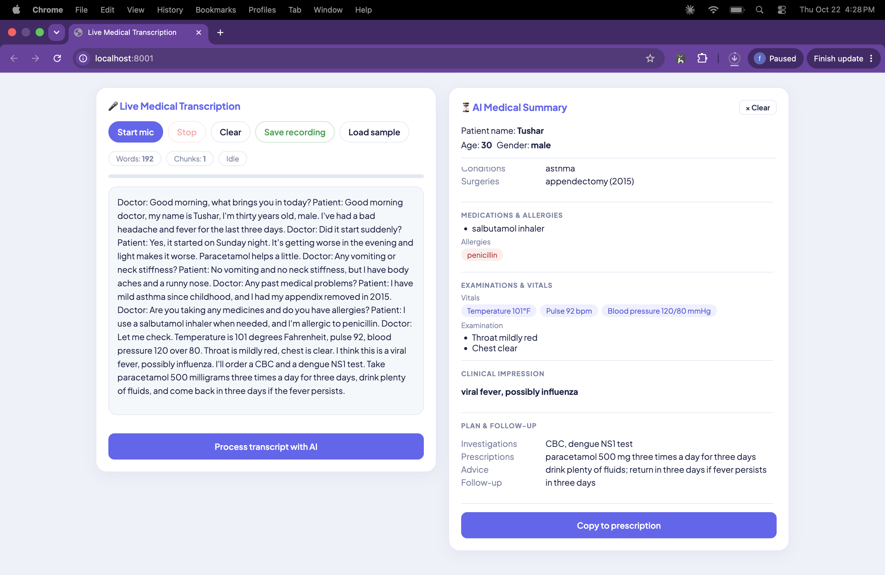

# Live Medical Transcription

A web app that listens to a doctor-patient consultation through the microphone,
shows the transcript live, and turns the finished transcript into a structured
clinical summary.



## What it does
1. Captures live audio from the microphone.
2. Detects speech with Voice Activity Detection (VAD), so silence and background
   noise are never sent for recognition.
3. Converts speech to text with OpenAI Whisper (`faster-whisper`).
4. Shows the transcript live: words appear in grey while you are still speaking,
   and the final text replaces them when you pause.
5. On "Process transcript with AI", sends the full transcript to an LLM.
6. Extracts structured medical information and shows a concise clinical summary.

Extracted fields: patient details, chief complaint, history of present illness,
symptoms (present and denied kept separate), past medical history, medications
and allergies, clinical observations (vitals, examination), assessment, and plan.

## Architecture
```
Browser                                     Python (FastAPI)
mic -> Silero VAD -> speech chunk (WAV) --> /api/transcribe -> Whisper -> text
full transcript ----------------------->    /api/summarize  -> LLM -> JSON -> summary panel
```

## Design choices
- **VAD runs in the browser** (Silero, via `@ricky0123/vad-web`). Silence and noise
  never leave the page, which cuts upload size and wasted recognition work.
- **Whisper runs locally** (`faster-whisper`, CPU, int8). Audio stays on the
  user's machine; only the transcript text is sent to the LLM.
- **Own WAV decoder.** The backend decodes the browser's WAV chunks directly
  with NumPy instead of PyAV/ffmpeg, which avoids a version conflict that
  caused crashes on some installs.
- **Structured output is validated.** Pydantic models (`backend/schemas.py`)
  define the summary; malformed LLM output is retried once, and numbers
  returned as numbers (e.g. `age: 30`) are accepted and stored as text.
- **Prompt safeguards:** the model must use only what was said, never invent
  diagnoses or doses, use `null` / `[]` for missing information, and keep
  stated negatives separate from positive symptoms.
- **Provider-agnostic LLM.** Any OpenAI-compatible API works (Groq, Gemini,
  OpenAI, local Ollama), plus Anthropic. Chosen in `.env`.
- **Live text while speaking.** The browser records the microphone itself (16 kHz)
  alongside the VAD. While you talk, the audio so far is re-transcribed about every
  1.2 s and shown as a grey live line; when you pause, the final text replaces it.
  Live requests only run during speech, so silence is still never sent.

## Tech stack
- Backend: Python, FastAPI, faster-whisper, Pydantic, OpenAI-compatible client
- Frontend: HTML5, CSS3, vanilla JavaScript, Silero VAD (ONNX, in the browser)

## Project layout
```
backend/    main.py (API), schemas.py (summary model), requirements.txt, .env.example
frontend/   index.html, style.css, app.js
sample_transcript.txt
```

## Run it
Requires Python 3.9+ and a microphone.

```bash
cd backend
python3 -m venv .venv
source .venv/bin/activate            # Windows: .venv\Scripts\activate
pip install -r requirements.txt
cp .env.example .env                 # Windows: copy .env.example .env
```

Open `.env` and set your LLM provider and key. For example, with Groq
(free key from console.groq.com):

```
LLM_PROVIDER=openai
LLM_BASE_URL=https://api.groq.com/openai/v1
LLM_API_KEY=your-key
LLM_MODEL=openai/gpt-oss-120b
```

Then start the server:

```bash
uvicorn main:app --reload --port 8001
```

Open http://localhost:8001 in Chrome (use `localhost` or HTTPS; browsers block
the microphone on plain HTTP elsewhere). The first start downloads the Whisper
model, and the VAD files load from a CDN, so internet is needed at first.

## Try it without speaking
Click **Load sample**, then **Process transcript with AI**.

## Troubleshooting
| Problem | Fix |
|---|---|
| `model_not_found` from the LLM | Pick a model your key can use (see the model list in the Groq console docs) and update `LLM_MODEL`|
| Summary fails on validation | Retry; the app already retries once and accepts numeric values |
| Medical words misheard | Set `WHISPER_MODEL=small` (or `medium`) in `.env` |
| Mic does not start | Allow microphone access in Chrome; check the browser console for VAD load errors |

## Limitations
- Whisper `base` can mishear drug names; larger models are slower but better.
- Chunks are transcribed after each pause, so a phrase may be split across chunks.
- Speaker roles (doctor vs patient) are inferred by the LLM, not detected from audio.
- Summaries can contain mistakes, so a clinician must review every one.

## Privacy
Audio is processed locally and is not stored. Only the transcript text is sent
to the configured LLM provider. Keep your `.env` file private and never commit it.
